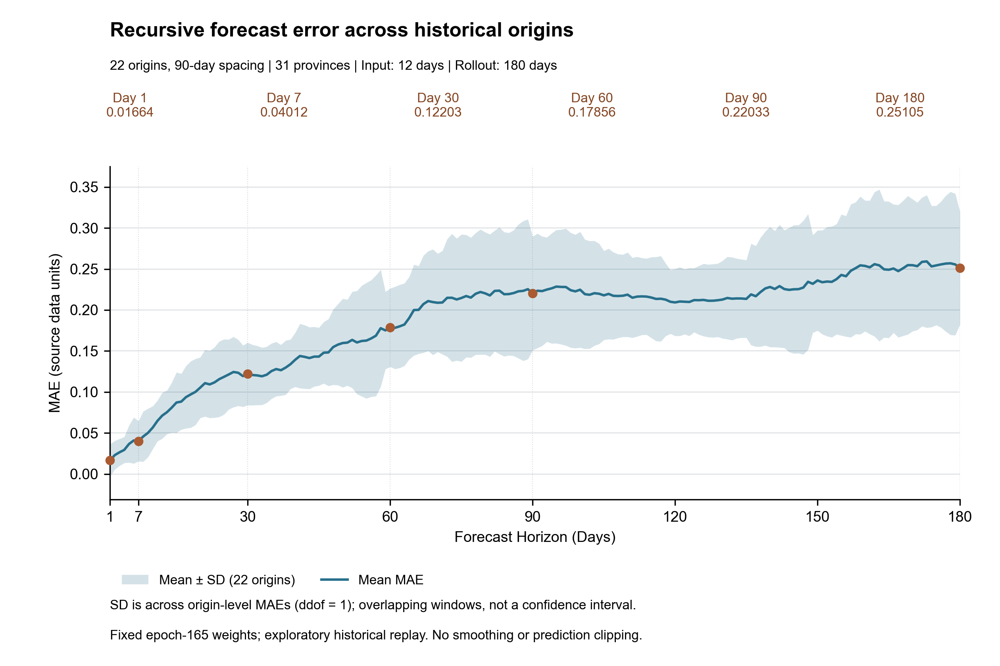

# 多历史起点的180天递归误差分析

这是现有 Carbon-ST/PDFormer epoch 165 权重的探索性历史回放，不重新训练。输入12天，每次只取模型输出第1天并回填，连续递归180次。

## 历史数据与22个起点

前2098行作为历史真值，末尾182行提供方预测值全部排除。历史日期采用确认后的2019-01-03—2024-09-30。首次用2019-01-03—01-14初始化，预测2019-01-15—07-13。每隔90天设置起点，最后一次预测2024-03-19—09-14，共22个完整窗口。起点和行号详见origins.csv。

## 指标与图示

每个起点、每个时距的MAE是当天31省绝对误差的平均，RMSE是平方误差平均后开方；MAPE排除零真值，并记录有效数量。指标均指对应当天，不是累计平均。汇总曲线先计算各起点MAE，再对22个起点求均值及样本标准差（ddof=1）。

实线为平均MAE，阴影为均值±样本标准差。相邻窗口重叠，这不是置信区间，22个起点也不是独立重复实验。不平滑曲线，不截断预测值。
阴影下界出现负值；这是均值减标准差的算术范围，不代表负MAE，绘图保留实际范围。

## 关键时距

| 时距（天） | 平均MAE    | MAE标准差   | 起点数 | 平均RMSE   | 平均MAPE（%） | MAPE有效值数 |
| -----:| --------:| --------:| ---:| --------:| ---------:| --------:|
| 1     | 0.016640 | 0.019727 | 22  | 0.023245 | 2.9413    | 682      |
| 7     | 0.040122 | 0.024526 | 22  | 0.064926 | 7.4656    | 682      |
| 30    | 0.122028 | 0.038151 | 22  | 0.192414 | 25.0112   | 682      |
| 60    | 0.178563 | 0.047839 | 22  | 0.230288 | 35.3402   | 682      |
| 90    | 0.220329 | 0.069364 | 22  | 0.285087 | 39.2363   | 682      |
| 180   | 0.251053 | 0.068764 | 22  | 0.334372 | 40.0535   | 682      |

RMSE和MAPE汇总列是各起点指标的算术平均；它们不是将所有省份与起点合并后计算的池化指标。MAPE无有效值的起点指标留空，平均时排除该项；本次有效数量可查表。

## 实际误差变化

第1天平均MAE=0.016640，第180天=0.251053，比值=15.088。最大平均MAE=0.259265（第173天），最小=0.016640（第1天）。179次相邻变化中114次上升、65次未上升；不能将曲线解释为必然单调递增。

误差变化同时受递归反馈、日期特征、真实序列变化及模型偏差影响；不能仅凭本图将变化全部归因于递归误差累积。

## 解释边界

- 早期窗口包含模型训练期间的数据，不能作为对未知数据的预测能力或严格样本外评估证据。
- 旧DTW基于整段2100行，包含测试历史及后来界定为提供方预测值的第2099、2100行。评分排除这些预测行，但固定权重及旧特征仍存在信息泄漏，不能宣称严格无泄漏。
- 每90天启动180天窗口，会重叠90天；标准差只描述窗口间波动，不支持独立重复实验的推断。
- 第1天对应各窗口第13天；首次为原始第13行，首次第180天为第192行，末次为第1903—2082行。

## 回应

Thank you for highlighting the need to assess error growth over extended recursive forecasts. We have clarified the forecasting procedure: the model uses a 12-day input window, retains the first predicted time step, and feeds this prediction back into the subsequent input window. This process is repeated to generate the long-horizon forecasts.
We additionally conducted an exploratory historical rollout analysis using the fixed epoch-165 model across 22 origins spaced 90 days apart. Each rollout generated 180 daily predictions without updating the input with observed emissions after the forecast origin. The mean MAE at horizons of 1, 7, 30, 90, and 180 days was 0.01664, 0.04012, 0.12203, 0.22033, and 0.25105, respectively; the corresponding mean MAPE was 2.94%, 7.47%, 25.01%, 39.24%, and 40.05%. These results show an overall deterioration in accuracy with increasing forecast horizon, although the error trajectory is not strictly monotonic.
This analysis demonstrates the operational feasibility of generating 180-day recursive forecasts, but does not establish their long-horizon accuracy. Because some rollout periods overlap with model training and the existing DTW features incorporate later data, the results are interpreted as exploratory rather than strictly out-of-sample evidence. We have accordingly removed the claim that recursive feedback reduces error accumulation and revised the manuscript to acknowledge the uncertainty of the six-month projections.